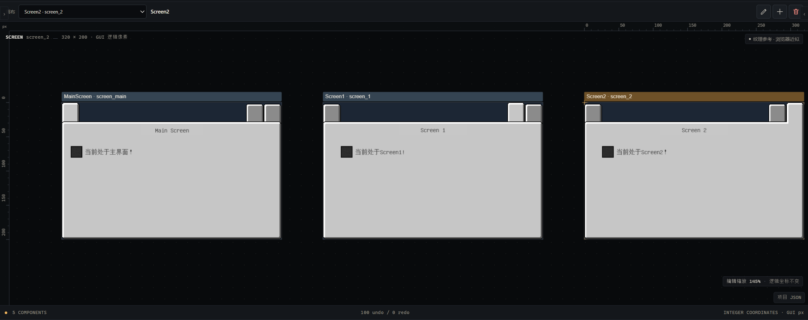
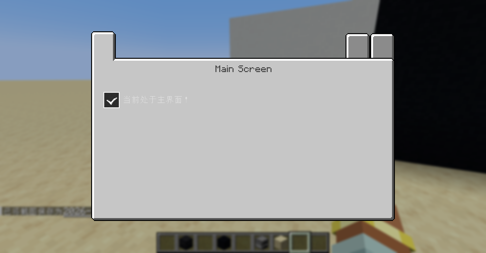
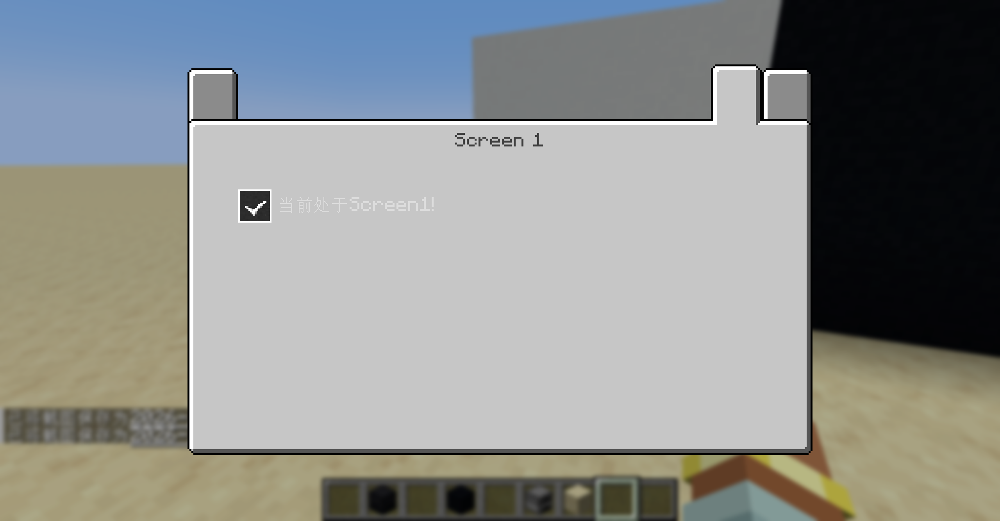
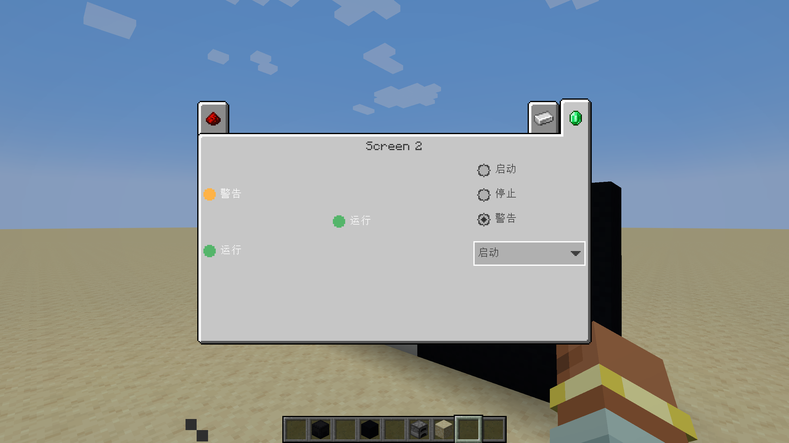
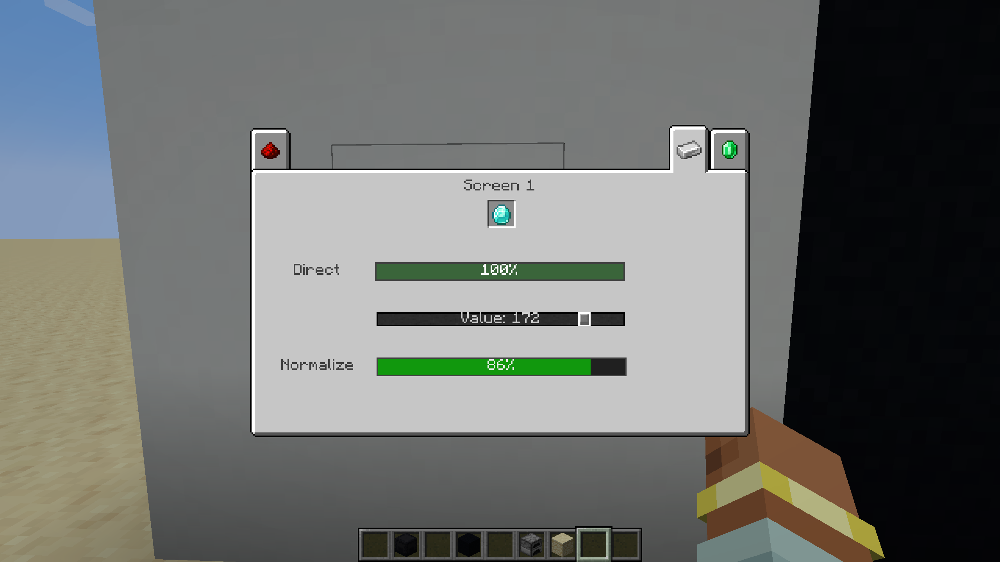
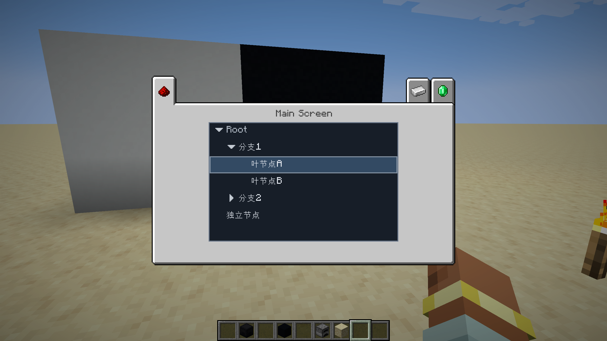
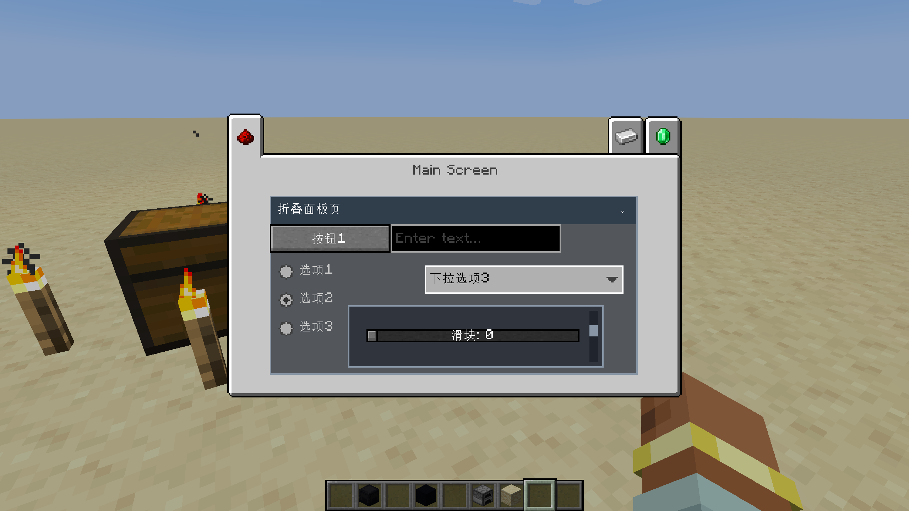

# Minecraft GUI Maker

一个用于设计 Minecraft GUI 的网页编辑器，目标环境为 Minecraft Java 1.21.1、NeoForge 21.1.244 和 Java 21。

项目提供 GUI 设计与 Blockly 行为编辑、本地保存，以及 JSON、参考 PNG、实现规格、Prompt 和 ZIP 导出。权威设计与行为保存在项目 JSON 中；游戏端依据导出的规格实现，不需要安装 Blockly，也不由网页自动生成 Java 源码。

## 当前功能

- Hybrid 工作区：Navigation Rail、可组合模块侧栏、Canvas 与 Inspector；支持侧栏固定/悬停展开、尺寸调整，以及浅色、深色和跟随系统主题。
- 组件设计：文本、按钮、输入、滑块、选择控件、进度条、状态指示器、Tree View，以及滚动和折叠容器。
- 有限行为编排：针对已支持的事件和动作，配置强类型比较、if/else、AND/OR/NOT、共享状态映射与同 Screen 控件运行值读取，并通过会话预览和日志检查执行结果。
- 编辑恢复：设计撤销重做、本机自动保存、Blockly 草稿保护及已保存规则的布局恢复；编辑器临时状态与游戏设计初值分开管理。

工作流程：**网页设计 → 权威 JSON → ZIP / 实现规格 → 开发者或 Codex 实现 → Minecraft 实测**。

## 演示

以下图片选自 [`docs/results`](docs/results)，展示代表性项目的设计与 Minecraft 游戏内效果。

### 编辑器工作区



上图为早期多 Screen 设计示例；当前正式编辑器已采用 Hybrid 工作区，并提供独立的 Blockly 行为模式。

### Minecraft 游戏内效果

| Main Screen | Screen 1 |
| --- | --- |
|  |  |

### 组件与联动示例

| 选择控件与状态指示器 | 滑块与进度条 |
| --- | --- |
|  |  |

| 树形层级与节点选择 | 折叠面板中的滚动容器 |
| --- | --- |
|  |  |

截图为代表性项目演示；浏览器近似预览与不同游戏环境下的实际视觉效果可能存在差异。GUI Maker 输出设计和实现规格，不自动生成或运行游戏代码。

## 运行

需要 Node.js 24.17.0 和 npm 11.13.0：

```sh
npm ci
npm run dev
```

使用浏览器打开终端显示的地址。构建使用 `npm run build`；单元测试使用 `npm test`，浏览器测试使用 `npm run test:e2e`（需安装 Playwright 浏览器）。测试源码位于 `tests/`，其中 `tests/unit/` 为单元测试。测试报告仅保存在本地。

仓库包含用户提供的 `src/gui/panel_16x.png` 和对应元数据。该纹理由 Minecraft 发射器 GUI 纹理裁切拼接；使用或分发 Minecraft 相关素材时，请自行确认适用的权利和条件。旧版 32× Panel 素材不包含在仓库中；需要该兼容样式时，可在本地提供 `src/gui/panel_32x.png`。

设计默认保存在当前浏览器的本地存储中，建议导出 JSON 备份。

## 开发状态

当前为持续开发中的阶段性版本。类型检查、构建与定向自动化按变更范围执行；完整工程回归仍有待处理项，阶段性功能验收不代表所有测试已通过。

## 许可证

项目代码采用 [MIT 许可证](LICENSE)。该许可证不授予 Minecraft 或用户提供的其他第三方素材的权利。
